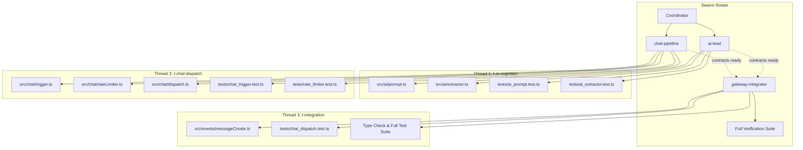

# Swarm Execution Plan: Gridgeist Interactive Bot Logic

This plan turns the implementation strategy for Gridgeist's interactive core logic into a coordinated multi-agent Swarm. Work is sharded across specialized workers operating in parallel, keeping the codebase modular and verifying each layer with automated test suites.

---

## Swarm Goal

- **Title:** Build Gridgeist Core Interactive Loop
- **Goal Line:** Dynamic prompt composer, background extractor, chat dispatcher, and gateway integration.



---

## Worker Roster & Workspaces

| Worker Name | Role | Workspace Mode | Assigned Scope & Owned Files |
| :--- | :--- | :--- | :--- |
| `ai-lead` | AI Persona & Memory Specialist | `share` (isolated working copy) | `src/ai/prompt.ts`, `src/ai/extractor.ts`, `src/ai/index.ts`, `tests/ai_prompt.test.ts`, `tests/ai_extractor.test.ts` |
| `chat-pipeline` | Chat Flow & Protocol Engineer | `share` (isolated working copy) | `src/chat/trigger.ts`, `src/chat/rateLimiter.ts`, `src/chat/dispatch.ts`, `tests/chat_trigger.test.ts`, `tests/rate_limiter.test.ts` |
| `gateway-integrator` | Gateway & Verification Lead | `inherit` (main repo) | `src/events/messageCreate.ts`, `tests/chat_dispatch.test.ts`, full test suite execution |

---

## Execution Threads & Worker Briefs

### Thread 1: `t-ai-cognition` (Owner: `ai-lead`)
- **Outcome:** Dynamic prompt synthesis based on persona, affinity tiers, player dossier, guild mood, and non-blocking background fact/affinity extraction.
- **Worker Brief for `ai-lead`:**
  > You own `src/ai/prompt.ts`, `src/ai/extractor.ts`, `src/ai/index.ts`, and their test suites in `tests/ai_prompt.test.ts` and `tests/ai_extractor.test.ts`.
  > 1. Implement `composeSystemPrompt` and `getAffinityGuidance` in `src/ai/prompt.ts` with zero Seyfert dependencies. Handle 4 affinity tiers (Hostile <= -26, Neutral -25 to 25, Friendly 26 to 75, Devoted >= 76), dossier summary, remembered facts, guild mood, and channel transcripts.
  > 2. Implement `extractMemories` in `src/ai/extractor.ts` using `generateStructuredOutput` with `extractedMemorySchema` (facts array, affinityDelta -5 to 5, summaryUpdate). Persist memory updates atomically via `playerRepo.addFactsAndAdjustAffinity` and `playerRepo.updateSummary`. Ensure all background failures are caught so they never throw.
  > 3. Write comprehensive unit tests in `tests/ai_prompt.test.ts` and `tests/ai_extractor.test.ts`.
  > 4. Verify by running `PATH="$HOME/.local/share/mise/installs/bun/latest/bin:$PATH" bun test tests/ai_*.test.ts`. Report completion on the board.

### Thread 2: `t-chat-dispatch` (Owner: `chat-pipeline`)
- **Outcome:** Message trigger evaluation, sliding-window rate limiting, and response dispatch pipeline.
- **Worker Brief for `chat-pipeline`:**
  > You own `src/chat/trigger.ts`, `src/chat/rateLimiter.ts`, `src/chat/dispatch.ts`, and unit tests in `tests/chat_trigger.test.ts` and `tests/rate_limiter.test.ts`.
  > 1. Implement `shouldRespondToMessage` in `src/chat/trigger.ts`: return true for DMs (`!guildId`), direct bot mentions (`<@botId>`, `<@!botId>`), or replies to bot messages (`referencedAuthorId === botId`); return false for bots or background chatter.
  > 2. Implement `SlidingWindowRateLimiter` in `src/chat/rateLimiter.ts` (default 5 requests per 30 seconds per user).
  > 3. Implement `handleChatMessage` in `src/chat/dispatch.ts`: rate limit check, trigger typing indicator (`client.channels.typing`), load dossier + mood + formatted buffer, invoke `generateChatReply`, sanitize mentions via `sanitizeMentions`, chunk via `splitMessage`, send sequential replies, and enqueue non-blocking background extraction via `queueMicrotask(() => extractMemories(...))`.
  > 4. Verify unit tests with `PATH="$HOME/.local/share/mise/installs/bun/latest/bin:$PATH" bun test tests/chat_*.test.ts tests/rate_limiter.test.ts`. Report completion on the board.

### Thread 3: `t-integration` (Owner: `gateway-integrator`)
- **Outcome:** Gateway event connection and end-to-end verification.
- **Worker Brief for `gateway-integrator`:**
  > You own `src/events/messageCreate.ts` and the end-to-end test suite `tests/chat_dispatch.test.ts`.
  > 1. Once `ai-lead` and `chat-pipeline` land their changes, update `src/events/messageCreate.ts` to wire `shouldRespondToMessage` and `handleChatMessage`. Ensure normal buffering and player upserting continue to run for every message.
  > 2. Add integration tests in `tests/chat_dispatch.test.ts` testing the end-to-end flow from message dispatch to chunked replies and microtask extraction queueing.
  > 3. Execute the full project verification loop:
  >    - `PATH="$HOME/.local/share/mise/installs/bun/latest/bin:$PATH" bun x tsc --noEmit`
  >    - `PATH="$HOME/.local/share/mise/installs/bun/latest/bin:$PATH" bun test`
  > 4. Confirm all 130+ tests across all suites pass with 0 failures and report back on the board.

---

## Swarm UI Plan Overview (`plan.json`)

When the swarm is launched, the coordinator will initialize the Swarm title and write `<appData>/brain/<conversation id>/.system_generated/swarm/plan.json`:

```json
{
  "goal": {
    "title": "Build Gridgeist Core Interactive Loop",
    "line": "Dynamic prompt composer, background extractor, chat dispatcher, and gateway integration."
  },
  "tasks": {
    "ai-lead": "Dynamic prompt composer and background memory extractor",
    "chat-pipeline": "Trigger detection, rate limiter, and response dispatcher",
    "gateway-integrator": "Wire messageCreate event and run end-to-end verification"
  },
  "threads": [
    {
      "id": "t-ai-cognition",
      "title": "AI Persona & Background Memory",
      "goal": "Synthesize dynamic persona prompt and extract facts/affinity non-blocking.",
      "tasks": ["ai-lead"]
    },
    {
      "id": "t-chat-dispatch",
      "title": "Chat Trigger & Dispatch Pipeline",
      "goal": "Handle triggers, rate limits, typing indicators, and chunked replies.",
      "tasks": ["chat-pipeline"]
    },
    {
      "id": "t-integration",
      "title": "Gateway Wiring & Full Verification",
      "goal": "Wire messageCreate to dispatch and pass all integration test suites.",
      "tasks": ["gateway-integrator"]
    }
  ]
}
```

---

## Verification Plan

### Automated Test Matrix
| Suite | Command | What is Verified |
| :--- | :--- | :--- |
| `tests/ai_*.test.ts` | `bun test tests/ai_prompt.test.ts tests/ai_extractor.test.ts` | Affinity tier prompts, fact injection, mood handling, Zod structured memory extraction, fallback resilience |
| `tests/chat_*.test.ts` | `bun test tests/chat_trigger.test.ts tests/rate_limiter.test.ts` | Trigger regex matching, reply author resolution, DM detection, sliding-window rate limiting |
| `tests/chat_dispatch.test.ts` | `bun test tests/chat_dispatch.test.ts` | Full messageCreate flow: buffering, trigger check, typing indicator, reply chunking, async extraction trigger |
| **All Test Suites** | `PATH="$HOME/.local/share/mise/installs/bun/latest/bin:$PATH" bun test` | Complete suite across all 8+ test files |
| **Type Check** | `PATH="$HOME/.local/share/mise/installs/bun/latest/bin:$PATH" bun x tsc --noEmit` | Strict TypeScript compilation with zero type errors |
